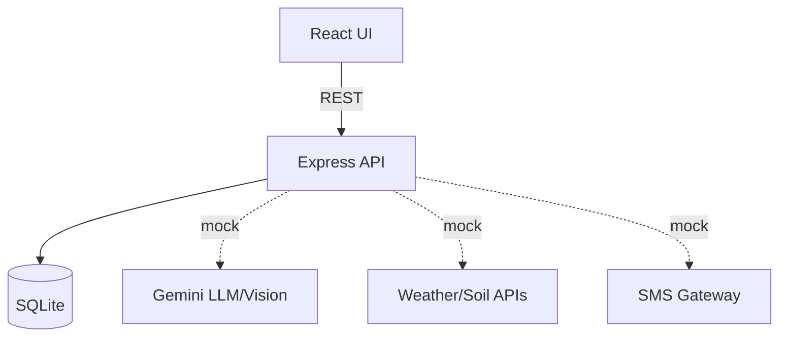

# Kisan Mitra AI

Voice-and-SMS agricultural intelligence platform for small farmers in India (hackathon MVP). Replaces habit-based farming with guidance from soil, weather and groundwater data.

**Live demo:** https://kisan-mitra-ai-two.vercel.app


## Features
1. **Crop Recommendation:** soil + groundwater + 7-day rainfall → best Kharif/Rabi/Zaid crops
2. **Alerts:** simulated weather cron triggers SMS and in-app notifications
3. **Crop Health:** photo upload; low-confidence cases escalate as tickets to the nearest Rythu Seva Kendra
4. **Accessibility:** English, Hindi, Telugu + text-to-speech

> AI, weather, soil and SMS services are **mocked** in this MVP (see roadmap).

## Tech Stack
React, Vite, TailwindCSS, react-i18next, Node.js, Express, SQLite (in-memory)

## Architecture


## Setup
```bash
cd backend && npm install && npm start     # :3001
cd frontend && npm install && npm run dev
```

## Screenshots


## Roadmap
Real Gemini/Vision integration, Twilio/Exotel IVR+SMS, live IMD/ISRIC/CGWB data, offline service worker.
